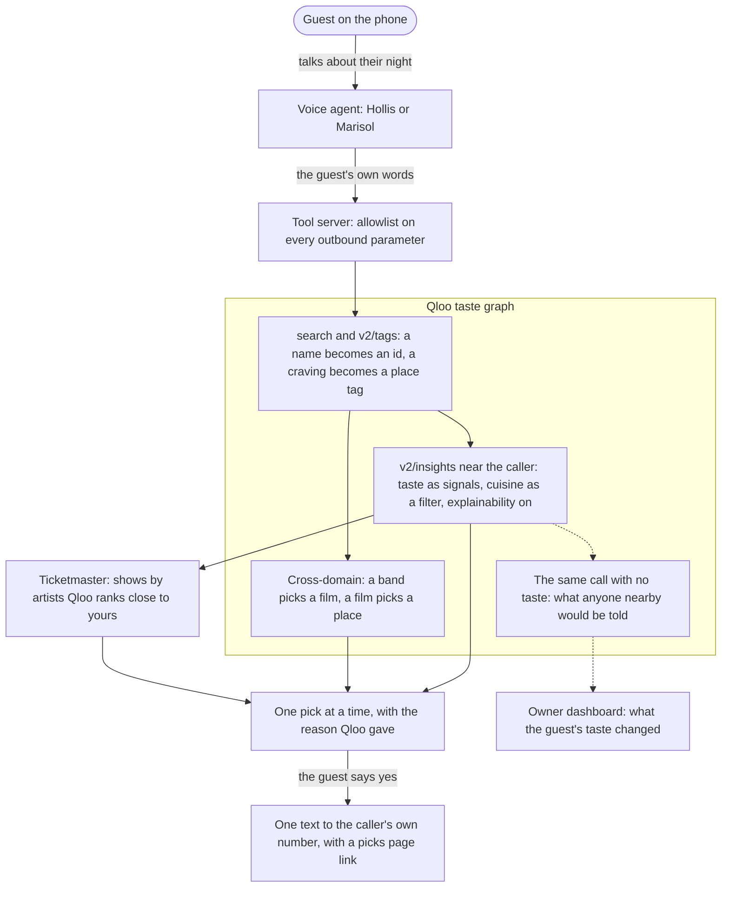

# Bellhop Concierge

<!-- PITCH: the one line below is the swap point for a headline or tagline. -->
**Call a number, talk about your night, get one good pick at a time and a text with the plan: a
phone concierge for small inns and short-term rentals, with Qloo's taste graph doing the
picking.**

**Call (833) 658-4321** ·
[Live site](https://concierge.southernsky.cloud) ·
[Watch the films](https://concierge.southernsky.cloud/#film) ·
<!-- YOUTUBE -->
[How we use Qloo](docs/QLOO.md) ·
[Devpost](https://devpost.com/software/bellhop-concierge) ·
[AGPL-3.0](LICENSE)

<!-- HERO: uncomment when docs/media/hero.png is committed.

-->

A twelve-room inn doesn't have a concierge. It has an innkeeper who is also the plumber, the
baker, and the person who picks up the phone at 11pm. A rental has no front desk at all. This
puts a concierge on the room card: a guest calls, chats about their night, and the concierge
listens for the things they love (a show, a band, a craving) and turns them into places nearby
that fit, each with the reason it fits. Built for the
[Qloo Agentic Hackathon](https://qloo.devpost.com/), October 2026.

## Judge in 60 seconds

1. **Call (833) 658-4321.** That's Hollis, the road concierge, for any city in the United
   States. Say where you are and mention something you've been into. She gives one pick at a
   time, waits for your reaction, and offers to text the plan. The text links to a picks page;
   on the live server it is sent from the same toll-free number (`SMS_FROM_NUMBER` in the
   server's env).
2. **Open [`/property/miami`](https://concierge.southernsky.cloud/property/miami).** Casa
   Coralina, a fictional short-term rental in Miami, and the dashboard its owner would see:
   the text a guest gets, where every line came from, and the Qloo request behind each pick.
   Its concierge is Marisol, who answers the stay questions first (checkout, parking, trash
   night) and then asks about your evening. **Call Marisol at (706) 810-9262** to play the
   guest at Casa Coralina.
3. **Check the switches yourself.** The server says which services are live, so you don't have
   to take our word for it:

   ```bash
   curl -s https://concierge.southernsky.cloud/health
   # "qloo":"live","ticketmaster":"live","sms":"live", and the eleven tools by name
   ```

More of a reader than a caller? [docs/JUDGES.md](docs/JUDGES.md) maps each judging criterion to
the code and the measurement behind it.

## One call



The same path as a sequence, tool by tool: [docs/ARCHITECTURE.md](docs/ARCHITECTURE.md).

## Why Qloo is load-bearing

- **The voice agent knows no places.** Every place, film, show, and reason a caller hears comes
  back from a tool call on that call, and the tools ask Qloo first. Each tool response records
  its upstream requests (`meta.upstream`), and the dashboard shows the request behind every pick.
- **The reason is Qloo's, or it says so.** The reason line comes from Qloo's explainability,
  which names the entities that drove a pick. Explainability never attributed a tag (0 times in
  90 live results), so a cuisine is said as a fact read from the place ("tagged Thai"), never
  as "fans of". ([docs/QLOO.md](docs/QLOO.md#4-explainability-the-reason-line))
- **Taste changes the answer, and we measure it.** Every place call runs twice, with the
  guest's taste and without. The guest's list moved away from the town's popular list for 12
  of 12 callers in the latest live battery run. ([docs/MEASUREMENTS.md](docs/MEASUREMENTS.md))
- **Thirteen Qloo capabilities, each tied to a decision.** Entity and tag search, place
  insights, cross-domain picks, per-person scoring for a plus-one, the no-taste contrast,
  heatmaps, demographics, tag leanings, and compare. A stated cuisine sent only as a signal
  showed up in 0 of 5 top picks; sent as a filter, in every one. So a cuisine is a filter here.
  ([docs/QLOO.md](docs/QLOO.md))
- **The owner's panels are the callers' own tastes.** The ids callers resolved pool into a
  fingerprint per property, and the heatmap, demographics, and lean lists are asked of it,
  dark until five calls are in.

## What the guest gets

- **A friend on the phone, not a form.** Nobody is asked to name a favorite from memory. A show
  mentioned in passing is the signal. One pick at a time, the reason in a few words, then a
  pause for the guest to react; a "meh, too loud" steers the next one.
- **Fresher picks.** Films and shows lean to the last three years unless the guest asks for
  older, a "lesser known" ask caps popularity, and what it already offered you doesn't come
  back.
- **A text with the plan,** to the number that called, with one link to a picks page
  (`/p/<token>`, gone after 30 days).
- **Memory, on a short leash.** Call back and the concierge remembers your first name, your
  town, your tastes, and what it already texted you, so the second call starts where the first
  left off. Ask it to forget you and `forget_guest` clears it. Memory lasts a week after the
  last call by default and never more than 30 days from the first. It is off unless the server
  has `GUEST_MEMORY_SECRET` set; the live server does.

## What the owner gets

- **A concierge compiled from one config file.** Each property is a JSON config
  ([`config/examples/`](config/examples/)) that [`bin/compile.js`](bin/compile.js) turns into a
  linted voice agent: the favorite spots and why, the house rules, the stay sheet, the persona.
  One concierge per number, no transfers.
- **Guardrails that can't be switched off.** Twelve locked rules: it says it's automated, says
  the call is recorded, and never speaks a door code, takes a payment, or names a place that
  didn't come from Qloo, Ticketmaster, or the owner's own notes.
- **A dashboard and a brief.** Calls, the exact text a guest got and the source of every line,
  area insights, and a one-page brief with tear-off room cards. Build your own at
  [`/build`](https://concierge.southernsky.cloud/build).

## What we learned

From checking a docs-first client against the live API. All twelve lessons are in
[docs/LEARNED.md](docs/LEARNED.md).

- **A requirement is a filter, not a signal.** "Thai" sent as a signal produced no Thai place.
- **Scores can be close while ranks are not.** Two people's affinities for one shortlist sat
  within a few hundredths, so a score threshold called every pick "for both". A rank rule
  replaced it.
- **The top pick isn't the proof; the list is.** With and without taste, the top pick sometimes
  matched while the rest of the list moved entirely.
- **A slow right answer is a wrong answer on the phone.** A town as a signal took about thirteen
  seconds, far too long for a caller waiting on the line. It became a filter.

## Honest limits

1. **Hours go stale.** The concierge never invents an opening hour, and can't promise one either.
2. **Speech recognition mishears names.** The concierge says each name back, and a name the
   tools can't find gets "what is it most like?" instead of a guess.
3. **Distances are as the crow flies.** It says "about a quarter mile", never "five minutes".
4. **Small towns are thin.** Near a small city a cuisine filter can find single digits of
   places, so the filter relaxes once and the concierge stops claiming the cuisine.
5. **Demographics describe people who share these tastes nearby,** never a caller.
6. **US only, by city name,** on Open-Meteo's free, non-commercial geocoder and forecast.
7. **The line has limits.** 300 calls a day, 3 at once, 10 texts per call, 12 per number per
   hour. Hackathon keys end after the event; `CACHE_FREEZE=1` keeps a pre-warmed demo answering.

Where every number on this page comes from: [docs/MEASUREMENTS.md](docs/MEASUREMENTS.md). What
leaves the server and what is never stored: [docs/PRIVACY.md](docs/PRIVACY.md).

## Run it yourself

Node 20 or newer, no keys needed. Mock mode answers from hand-written fixtures with fictional
places.

```bash
git clone https://github.com/StankyDanko/bellhop-concierge && cd bellhop-concierge
npm install
npm test                      # the offline suite; it prints its own count
npm run battery -- --mock     # simulated callers, scored against the battery criteria
npm run mock                  # the tool server and dashboard API on :8787
curl -s -X POST localhost:8787/tools/resolve_taste \
  -H 'X-Concierge-Secret: local-dev-secret-change-me' -H 'content-type: application/json' \
  -d '{"mentions":["Sturgill Simpson","thai food"]}'
npm run compile -- config/examples/miami-rental.json   # Casa Coralina as an agent definition
```

The npm scripts call `/usr/bin/node`; if your Node lives elsewhere, run the same files with
`node`. Live mode reads keys from `server/.env` (`npm run live`); the variables are in
[`server/README.md`](server/README.md). What each test layer proves:
[docs/TESTING.md](docs/TESTING.md).

## What's in the repo

| Path | What it is |
|---|---|
| [`server/`](server/README.md) | The tool server: eleven tools over Qloo, Ticketmaster, and the text sender, the PII guard, a private cache, guest memory, the dashboard API, the battery. |
| [`compiler/`](compiler/README.md), [`bin/compile.js`](bin/compile.js) | A config and a persona in, a linted voice agent definition out. |
| [`config/`](config/examples/) | The config schema and the examples: Hollis's road line, Casa Coralina, and a sample inn. |
| [`template/`](template/concierge.md), [`personas/`](personas/README.md) | The concierge prompts with their locked rules, and the voices. |
| `dashboard/` | The landing page, the builder, the owner dashboard, and the printable brief (React, Vite). |
| [`docs/`](docs/ARCHITECTURE.md) | Architecture, Qloo use, what we learned, measurements, privacy, testing. |
| [`QLOO-NOTES.md`](QLOO-NOTES.md) | Every Qloo shape we read from the docs, and how each held up live. |
| `deploy/`, `Containerfile`, `deploy.mjs` | How the demo ships. |
| [`CONTRIBUTING.md`](CONTRIBUTING.md) | How commits are kept, and the hooks every one passes. |

Where it's headed: [ROADMAP.md](ROADMAP.md).

## License

AGPL-3.0-only. See [LICENSE](LICENSE). This is the reference implementation; the hosted
product's hardening, client configs, and credentials are not in this repository. Qloo's terms
forbid storing their responses in a public repo, so every fixture here is a hand-written fake.

Not affiliated with Airbnb or any booking platform. Weather and geocoding by Open-Meteo.com
(CC BY 4.0).

---

Bellhop Concierge is an edition of Bellhop by SouthernSky. Built by
[StankyDanko](https://github.com/StankyDanko), one brick at a time. 🧱
