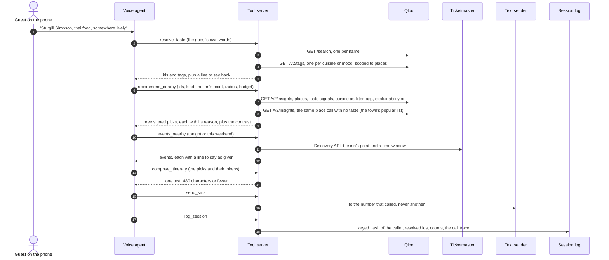

# Architecture

One phone call, start to finish, and where each piece lives. The server's own layout, file by
file, is the diagram at the top of [`server/README.md`](../server/README.md#architecture); this
page is the call's view of it.

## The call path



If the diagram doesn't render where you're reading, the same path in words:

```
guest ──> voice agent ──> POST /tools/<name>, header X-Concierge-Secret
                             │
          resolve_taste ─────┼──> Qloo /search, /v2/tags
          recommend_nearby ──┼──> Qloo /v2/insights (with taste) + (without taste)
          cross_domain ──────┼──> Qloo /v2/insights, another filter.type
          events_nearby ─────┼──> Ticketmaster Discovery
          compose_itinerary ─┤    pure: no network
          send_sms ──────────┼──> text sender, bound to the caller's number
          log_session ───────┼──> SQLite session log (hash, ids, counts)
          area_insights ─────┴──> Qloo heatmap, demographics, tag insights, compare
                                   (the innkeeper dashboard, never the call)
```

## The eleven tools

Counted from the server: `curl -s localhost:8787/health` lists them under `tools` (`TOOLS` and
`MEMORY_TOOLS` in `server/app.js`). All are `POST /tools/<name>` with a JSON body and the shared-secret header. Full contracts,
request and response shapes included, are in [`server/README.md`](../server/README.md#tool-contracts).

| Tool | Calls | What it returns |
|---|---|---|
| `resolve_taste` | Qloo `/search`, `/v2/tags` | Qloo ids and tags for the guest's words, the plus-one's separately, and what didn't resolve |
| `recommend_nearby` | Qloo `/v2/insights`: the taste call, the no-taste call, one per person when there is a plus-one, and one relaxed retry when a cuisine filter leaves fewer than three | places near the inn, each with a reason, a signed `pick_token`, and the no-taste contrast |
| `cross_domain` | Qloo `/v2/insights` | across categories: a film, a book, an artist, a podcast, a show, or a place, never one of the guest's own inputs |
| `events_nearby` | Ticketmaster Discovery | what's on tonight or this weekend, each with a line to say as given |
| `compose_itinerary` | none | the text, from verified tool fields only |
| `send_sms` | the text sender | sent or not, to the caller's own number, at most twelve to one number an hour and ten in one call |
| `log_session` | none | stores the session row and its call trace |
| `area_insights` | Qloo heatmap, demographics, compare | the innkeeper's panels, aggregate only |
| `forget_guest` | none | erases the caller's returning-guest memory at once; it has nothing to erase unless memory is on |
| `remember_guest` | none | notes the first name a caller gives, or whether a caller is still the person remembered on that phone; it answers the same either way and stores nothing unless memory is on |
| `stay_info` | none | one line about the stay, by topic, from the property's stay sheet; never a wifi password or a door code, and compiled only for a property that has a sheet |

## The pieces that keep it honest

- **One Qloo client.** Every Qloo call goes through `server/lib/qloo.js`. A wrong spelling is a
  one-line fix in a known place.
- **The PII guard.** `server/lib/pii-guard.js` checks every outbound Qloo parameter by name and
  value against an allowlist before the request leaves the process. A refused request never
  reaches the network, and a test proves it. See [PRIVACY.md](PRIVACY.md).
- **Signed picks.** `recommend_nearby` and `events_nearby` sign each item they return
  (`server/lib/pick-token.js`). `compose_itinerary` honors "you'll both like this" or "Tonight"
  only when the token verifies, so the text can't carry a claim the tools didn't make.
- **The why trace.** `server/lib/why.js` turns Qloo's explainability into the reason line, and
  says "Strong match for your overall taste" when Qloo attributed nothing.
- **The call trace.** Every upstream call is recorded on the response (`meta.upstream`, and a
  per-call trace on the session) with its endpoint, its parameters, and whether it was answered
  live, from cache, or from fixtures. The dashboard draws the request behind each pick from it.

## Mock, live, cache, freeze

Mock and live share every line above the transport, including normalization, so a test that
passes on fixtures walks the same code a live call does.

| Mode | How | Qloo calls |
|---|---|---|
| Mock | `npm run mock` (`QLOO_MOCK=1`, `TICKETMASTER_MOCK=1`) | none; answers from `server/fixtures/`, hand-written fakes |
| Live | `QLOO_API_KEY` in `server/.env`, then `npm run live` | real, through a private cache with a lifetime per endpoint |
| Cache only | `CACHE_ONLY=1` | none; a request not in the cache returns `cache_miss` |
| Cache freeze | `CACHE_FREEZE=1` | none; `/health` reports `"cache": "frozen"` |

Freeze is for the day the hackathon key goes dark. `npm run prewarm -- --apply` replays every
request shape the demo makes into the cache while the key works, one live call per two seconds.

## Where data lives

| What | Where | In git |
|---|---|---|
| Qloo and Ticketmaster responses | `server/data/cache.sqlite`, private | never (gitignored, refused by the pre-commit hook) |
| Sessions: caller hash, resolved ids, counts, trace | `server/data/sessions.sqlite` | never |
| Inn configs | `server/data/concierge.sqlite` | never; the demo inn's config is `config/examples/demo-inn.json` |
| Fixtures for tests and mock mode | `server/fixtures/` | yes, hand-written fakes with `fx-` ids and fictional places |
| Keys | `server/.env` | never |

What is never stored anywhere: a caller's number, a transcript, a message body. A first name is kept only in returning-guest memory, when memory is on ([PRIVACY.md](PRIVACY.md)).

## The innkeeper side

The dashboard (`dashboard/`, React and Vite, served by the same server) reads `/api/*`. Its
taste panels ask Qloo about the inn's callers, not the zip code: the resolved ids from every
call add up to a fingerprint (`server/lib/fingerprint.js`), which becomes the signal for the
heatmap, demographics, and the "your callers lean toward" list. Below five calls that named a
taste (`SESSION_GATE = 5` in `server/api/routes.js`), those panels stay dark.

The voice agent itself is compiled, not hand-written: `compiler/` takes an innkeeper's answers
and a persona and produces the agent definition, with the locked rules from
`template/concierge.md`. See [`compiler/README.md`](../compiler/README.md).
